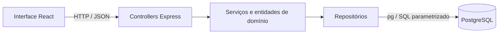

# Arquitetura e convenções técnicas

## Organização

Aplicação cliente-servidor: interface React consome uma API Express por HTTP/JSON; somente o backend acessa PostgreSQL. O frontend e o backend são workspaces do mesmo repositório, organizados pelos cinco módulos funcionais.



## Orientação a objetos

A estrutura prevista de cada módulo do backend é:

```text
modules/ensaios/
  entities/       Ensaio, ConfirmacaoEnsaio, Presenca
  services/       regras de negócio e coordenação dos repositórios
  repositories/   persistência PostgreSQL
  controllers/    tradução entre HTTP e as operações dos serviços
  routes.js       registro das rotas do módulo
```

Esse exemplo é uma convenção para a implementação futura; ainda não existem classes de domínio nessa base. Entidades encapsulam estado e comportamento. Serviços recebem suas dependências por construtor; repositórios concentram SQL. Evitar regras de negócio dentro dos componentes React e dos handlers HTTP. Herança deve ter justificativa de domínio; não é necessário criá-la apenas para demonstrar orientação a objetos.

## Integração entre módulos

- Usuários fornece identidade e perfil; o backend deve validar permissões em cada operação protegida.
- Estoque fornece tipos e unidades físicas. Confirmações referenciam o tipo pretendido e não reservam uma unidade.
- Ensaios mantém confirmação antecipada separada da presença efetiva e fornece os totais por tipo ao dashboard.
- Movimentações deve atualizar empréstimos, manutenção e situação das unidades de maneira transacional, evitando conflitos concorrentes.
- Dashboard calcula `max(0, confirmados - disponíveis)` por tipo. É uma previsão baseada no estoque atual.

## Convenções da API

- Prefixo `/api`; rotas de negócio serão acordadas e adicionadas ao contrato antes de integrar consumidores.
- Entradas e saídas JSON; erros no formato `{ "error": { "code": "CODIGO", "message": "Mensagem" } }`.
- Validar entradas, existência de recursos e permissões no backend. Nunca aceitar um perfil enviado pela interface como autorização.
- Usar consultas parametrizadas com `$1`, `$2`, etc. Transações com `pg` devem usar uma única conexão entre `BEGIN` e `COMMIT`/`ROLLBACK` e liberá-la ao final.
- O navegador não recebe `DATABASE_URL` ou credenciais. O proxy do Vite evita a necessidade de CORS no desenvolvimento local.
- Somente `/api/health` está implementada nesta base. Autenticação e rotas de negócio ainda não estão disponíveis.

## Banco e testes

Cada responsável propõe as tabelas e migrações do seu módulo, revisando vínculos compartilhados com a equipe. Restrições de unicidade e chaves estrangeiras complementam as validações dos serviços. Ver [convenções SQL](../database/README.md).

Testes de regras devem cobrir permissões, duplicidade, disponibilidade e falhas relevantes. Testes de integração que escrevem dados usam um banco exclusivo de teste. O workflow inicial executa lint, quatro verificações HTTP da base, build e `SELECT 1` em um PostgreSQL temporário; isso ainda não valida fluxos de negócio.
